<div align="center">


# Hearthspell

### Keep the tower, keep the home

*The old master has gone travelling and left his tower to you, his apprentice. The tower is your home: every floor is a room, every chore is a spell. Cast them and the floors shine. Forget one and harmless imps move in. Master your spells and animated helpers wake up. The master writes once a week, and the market trip is a quest for reagents. Cozy pixel art, no punishments, no ads, no account, works offline.*

[](https://github.com/bigdevwhale/hearthspell/actions/workflows/android.yml)
[](https://github.com/bigdevwhale/hearthspell/releases/latest)


[](LICENSE)

**English** · [Русский](README.ru.md) · [Website](https://bigdevwhale.github.io/stillcraft/apps/hearthspell/) · [Changelog](CHANGELOG.md)

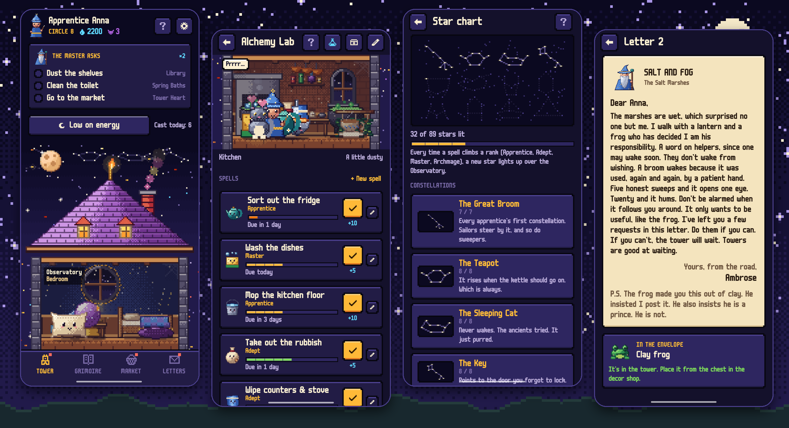

</div>

---

## The idea

Most chores aren't daily. You water the plants every four days, change the bed linen every two weeks and clean the oven once a moon. A checklist that resets every morning is the wrong shape for that, and a streak that breaks is the wrong feeling.

In Hearthspell every chore has its own rhythm. Its **freshness** fades slowly from bright to dusty, and the room in the tower fades with it: a little dust, then a cobweb, and once the time is up, an imp who chews socks and giggles. Do the chore, tap the spell, and the imp is swept out. Nothing burns down, nobody scolds you, and a dusty floor just waits for you to come back.

## The tower

| | What | How it works |
|---|---|---|
| 🏰 | **Floors are rooms** | 11 kinds of room, each with its own pixel scene: the kitchen is the Alchemy Lab, the bedroom an Observatory under a domed window, the bathroom the Spring Baths, the hallway the Gate Hall, the balcony a Greenhouse, plus the Library, Toy Workshop, Scriptorium, Weaving Room, Menagerie and the Tower Heart for whole-home spells. Rename them, reorder them, add more. |
| ✨ | **Spells are chores** | 45 ready-made spells with sensible intervals, from "wash the dishes" to "clean the oven", each with a small incantation. Or write your own: any name, any interval, three levels of effort. Pause a spell for a holiday. |
| 😈 | **Imps, not punishment** | A spell past its interval brings an imp to its floor. Imps are harmless and a bit cheeky. One cast sends one packing. |
| 🧹 | **Helpers wake up** | 17 helpers (Broom, Sponge, Bucket, Teapot, Watering Can, Candle, Key, Satchel…) each tied to their spells. Cast a spell five times and its helper wakes and starts pacing the floor; it grows through four levels. |
| 💧 | **Mana and decor** | Every cast earns mana: 5 for a cantrip, 10 for a spell, 20 for a great one. Spend it on 21 pieces of decor plus seasonal ones (a cat, a cauldron, a telescope, glowing mushrooms, a fireplace…) and place up to four on each floor. |
| 📜 | **The master's requests** | Each week the master asks for three spells that have waited longest. They're worth double mana until Sunday. |
| 🌙 | **Low on energy** | One button shows only the small spells, most urgent first. Even a small spell drives the imps out. |
| 🕯️ | **A living tower** | At night a tidy floor glows warm, a dusty one sinks into the dark and an imp's floor flickers violet. Late at night the helpers doze. When every floor is tidy a comet crosses the sky (a rainbow by day). |
| 🐾 | **Pat everyone** | Tap a helper and it hops, says something and hearts float up. A cat moves in after your first few spells, gets a name and sleeps wherever you've just tidied. Tap it and it purrs. |
| 🎃 | **Seasons** | Autumn leaves, Hallowe'en pumpkins and bats, winter snow on the roof, New Year garlands and fireworks, spring petals, summer butterflies. Seasonal decor comes back every year. |

## The rest of the house

- **The grimoire.** Your circle as an apprentice, every helper and its level, and a page for each spell: the incantation, its rank from Novice to Archmage, and a twelve-week calendar of casts.
- **The market.** The shopping list as reagents for the tower, sorted into shop sections with tower names (Gifts of the Field, Milk Rivers, Cleaning Elixirs…). The section is guessed from the name in English or Russian. The app learns how often you buy things and suggests what's running low. Market mode is a big one-hand checklist; finishing the trip casts your market spell.
- **Letters from the master.** Twelve letters, one a week, from Master Ambrose on his travels: salt marshes, a monastery of silent brooms, an old friend who is a dragon, the real reason he left, and the road home.
- **One quiet reminder a day,** in a helper's voice, only when imps have moved in or a letter has arrived.
- **The bestiary.** Eighteen named imps (Pip the Sock-Chewer, Crumbwhistle of the kitchen, Snorewick under the bed, a Hallowimp in a sheet…), each with a habit and a parting word. Which one moves in depends on the room and the season, never on how long a chore waited.
- **Gifts from the helpers.** After a quiet night on a tidy floor, its helpers may leave a trinket on the windowsill: a button, a feather, an acorn, now and then a rare star shard. Gifts wait three days. A shelf of seventeen to collect.
- **The star chart.** Every rank a spell climbs lights a star over the Observatory; the stars fill twelve constellations (the Great Broom, the Teapot, Pudding the Dragon…) and the lit ones shine over the roof at night.
- **The cauldron.** Every reagent bought at the market leaves an essence on the alchemy shelf. Brew them into potions that do nothing useful and make the tower prettier for a week: pink chimney smoke, rainbow fireflies, soap bubbles, flowers on the walls.
- **The wardrobe.** Robes and hats for mana: a flower crown, a frog cap, cat ears, a little crown. The apprentice walks about every floor in them.
- **Souvenirs.** Each of the master's letters brings something in the envelope: a clay frog, a dragon's scale, a ship in a bottle, a jar of northern lights.
- **Sunday tea.** On Sunday the helpers gather round the table and tell you about the week in a few warm lines. No charts.
- **Coming home.** Back after five days or more, the master welcomes you, the first spell is a Great Spring Cleaning with confetti and counts double. Nothing is ever lost for being away.
- **Sound and touch.** Little chiptune chimes, synthesised on the phone; spells cast in a row climb a scale and the buzz grows a little.
- **A home-screen widget**: the tower from outside, its windows warm where it's tidy and violet (with two yellow eyes) where imps moved in.

<table>
  <tr>
    <td>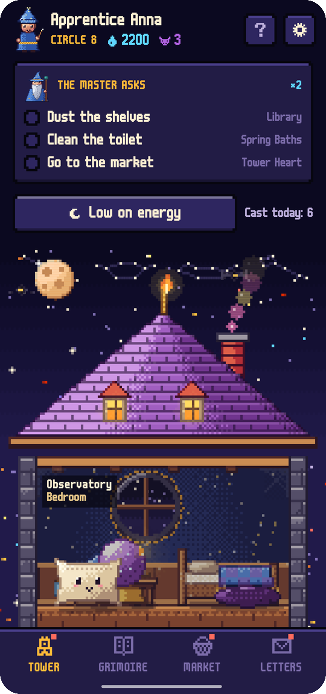</td>
    <td>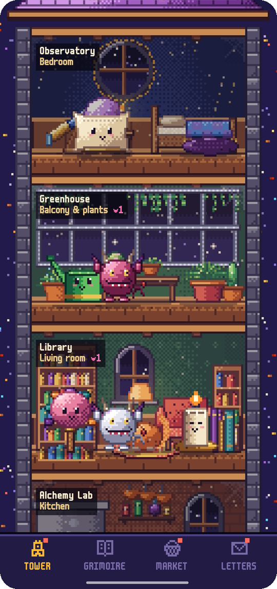</td>
    <td>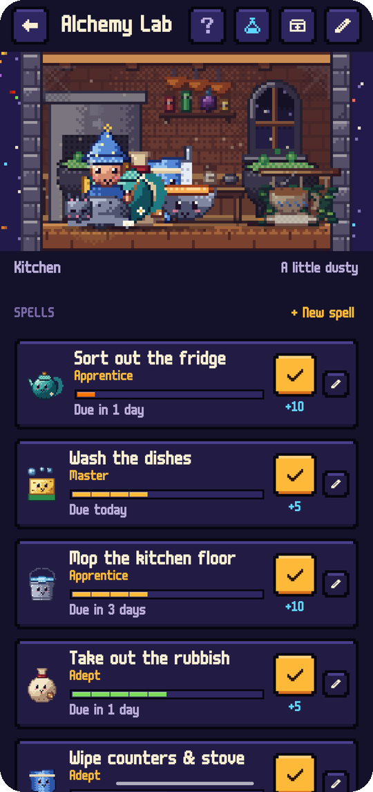</td>
    <td>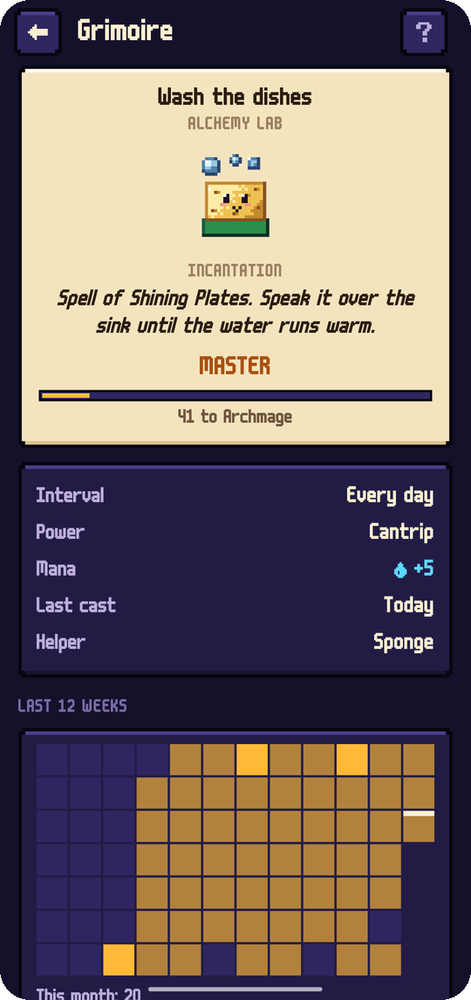</td>
  </tr>
  <tr>
    <td>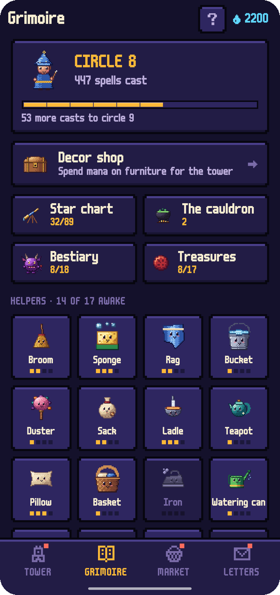</td>
    <td>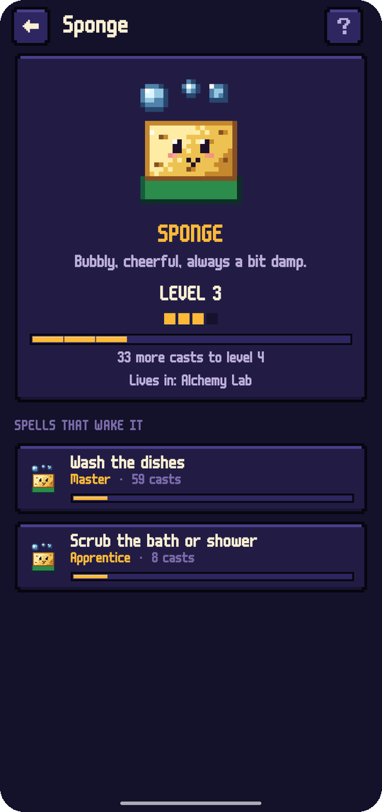</td>
    <td>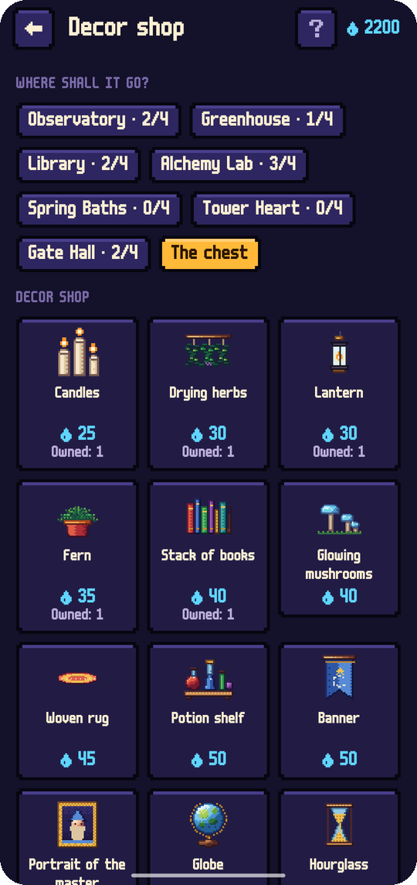</td>
    <td>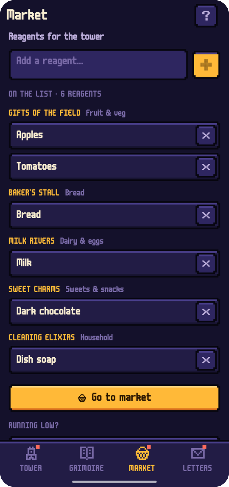</td>
  </tr>
  <tr>
    <td>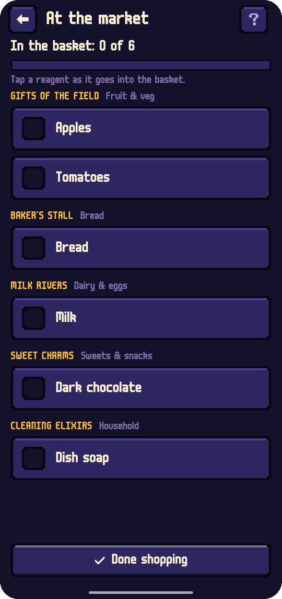</td>
    <td>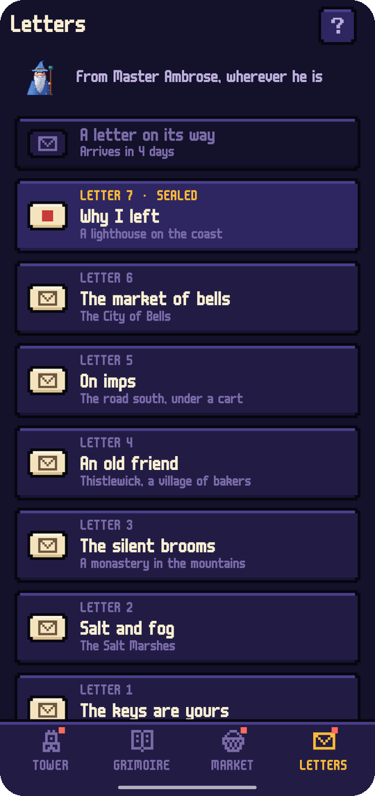</td>
    <td>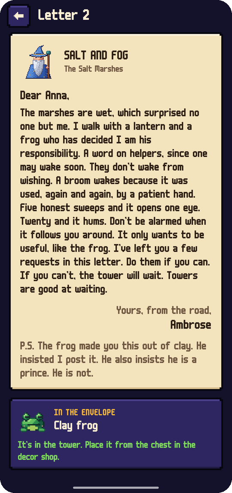</td>
    <td>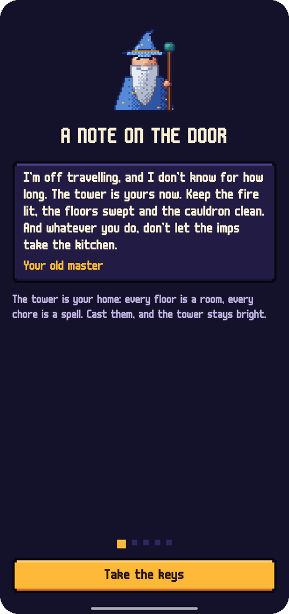</td>
  </tr>
  <tr>
    <td>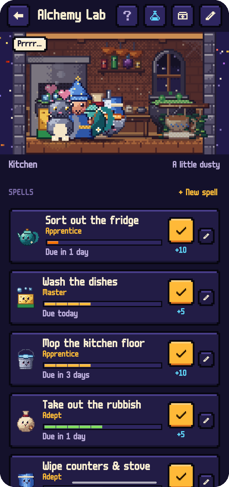</td>
    <td>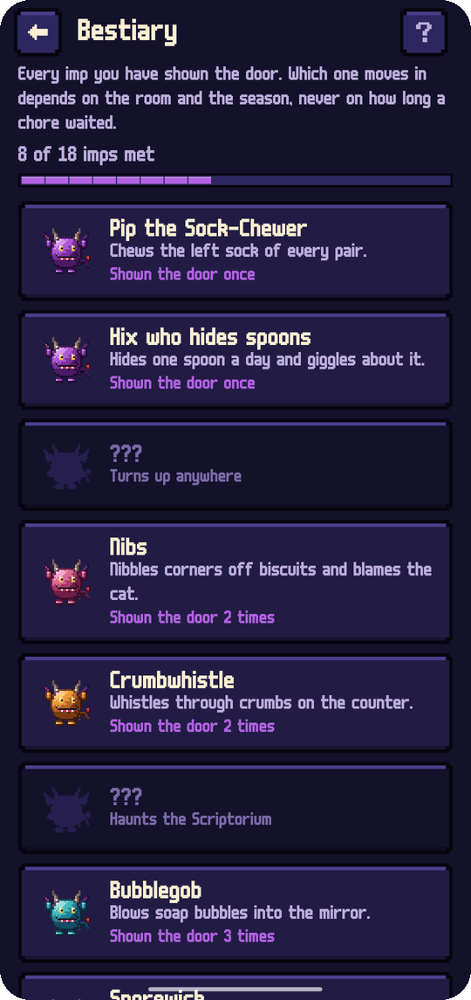</td>
    <td>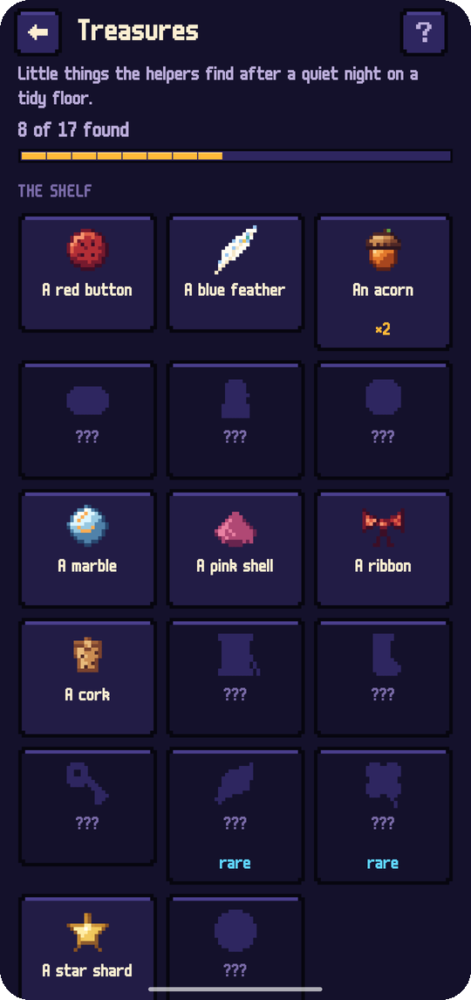</td>
    <td>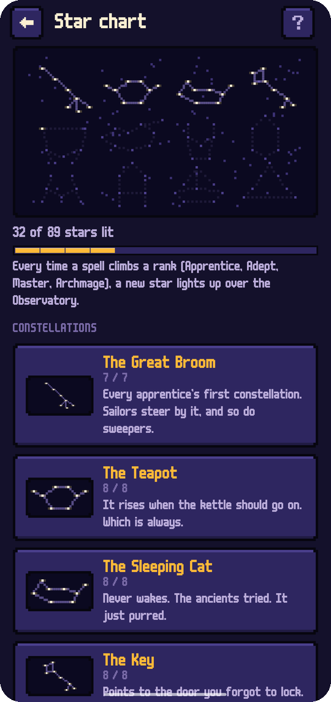</td>
  </tr>
  <tr>
    <td>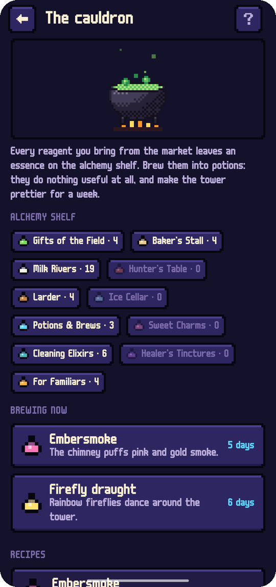</td>
    <td>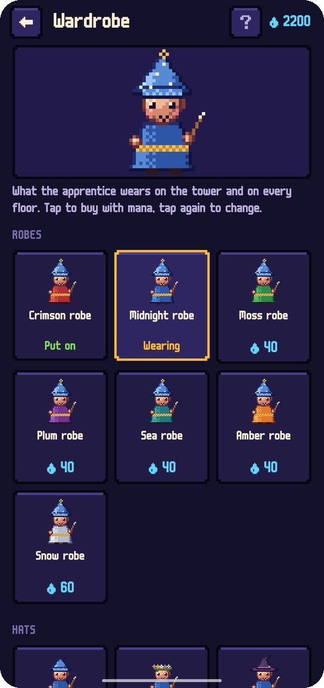</td>
    <td>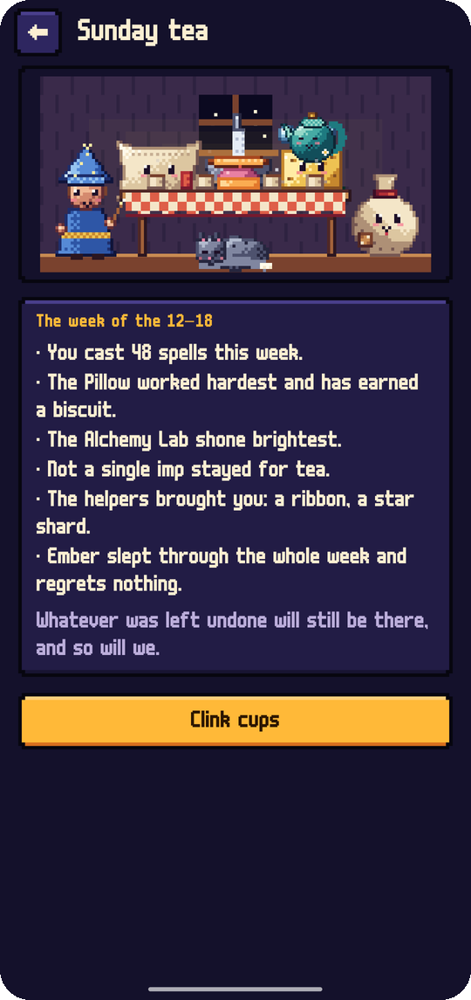</td>
    <td></td>
  </tr>
</table>

## English & Русский

Every screen, spell, incantation and letter is written natively in both languages, not machine-translated. In Russian the app asks whether you are an «ученик» or an «ученица» and the master writes to you accordingly. Switch in **Settings → Language**; on Android 13+ the app also appears in the system's per-app language settings.

## Download

Get the APK from **[Releases](https://github.com/bigdevwhale/hearthspell/releases/latest)**, or the debug APK attached to any [CI run](https://github.com/bigdevwhale/hearthspell/actions/workflows/android.yml). Hearthspell needs Android 8.0 (API 26) or newer.

> [!TIP]
> On Xiaomi (MIUI / HyperOS), Huawei and some other phones, allow **Autostart** and remove battery limits so the daily reminder arrives on time.

## Privacy

Hearthspell has no accounts, no servers, no analytics, no ads and no internet permission. Your tower, spells, casts and shopping list live on the phone. **Settings → Backup** exports everything to one JSON file you keep.

## Under the hood

- **Kotlin + Jetpack Compose** with a custom pixel UI: stepped-corner panels, buttons that sink when pressed, segmented bars, the m6x11 pixel typeface by Daniel Linssen with Cyrillic by Natto Games. A night theme and a parchment one.
- **The pixel art is generated by code.** `tools/art/` holds Python scripts (Pillow) that draw every helper, imp, piece of decor, floor scene and the launcher icon with hue-shifted colour ramps, shading by surface normals, ordered dithering, selective outlines and stepped glow. `export.py` writes the sprites into `ui/art/Art.kt` and the scenes into `res/drawable-nodpi`. In the app, sprites are drawn from cached bitmaps without filtering, so they stay crisp at any scale.
- **Room** stores floors, spells, casts, reagents and decor; **DataStore** holds the settings.
- `domain/World` holds the rules: freshness and imps, ranks, helper levels, mana, the master's weekly requests, letters and what's running low. It is plain Kotlin and covered by unit tests.

```
app/src/main/java/app/hearthspell/
├── content/     floors, spells, helpers, decor, shop sections, letters, aisle guessing (EN + RU)
├── data/        Room database, settings, JSON backup, demo seed
├── domain/      freshness, ranks, helpers, mana, requests, gender marks
├── notify/      the daily reminder
└── ui/          tower, grimoire, market, letters, decor, onboarding, settings, pixel art
tools/art/       the pixel-art generator
```

Build it with `./gradlew assembleDebug`. `./gradlew installDebug -Pdemo` installs `app.hearthspell.demo` with a lived-in tower and two months of history, the one used for these screenshots.

## License

[MIT](LICENSE). Part of [Stillcraft](https://bigdevwhale.github.io/stillcraft/), small tools for a quieter mind.
