<div align="center">


# Hearthspell

### Береги башню — береги дом

*Старый мастер ушёл странствовать и оставил башню тебе, своему ученику. Башня — это твой дом: каждый этаж — комната, каждое дело — заклинание. Произноси их, и этажи сияют. Забудешь — заведутся безобидные пакостники. Освой заклинание, и проснётся оживший помощник. Мастер пишет раз в неделю, а поход в магазин превращается в поход за реагентами. Уютный пиксель-арт, никаких наказаний, без рекламы и аккаунта, работает офлайн.*

[](https://github.com/bigdevwhale/hearthspell/actions/workflows/android.yml)
[](https://github.com/bigdevwhale/hearthspell/releases/latest)


[](LICENSE)

[English](README.md) · **Русский** · [Сайт](https://bigdevwhale.github.io/stillcraft/apps/hearthspell/) · [История изменений](CHANGELOG.md)

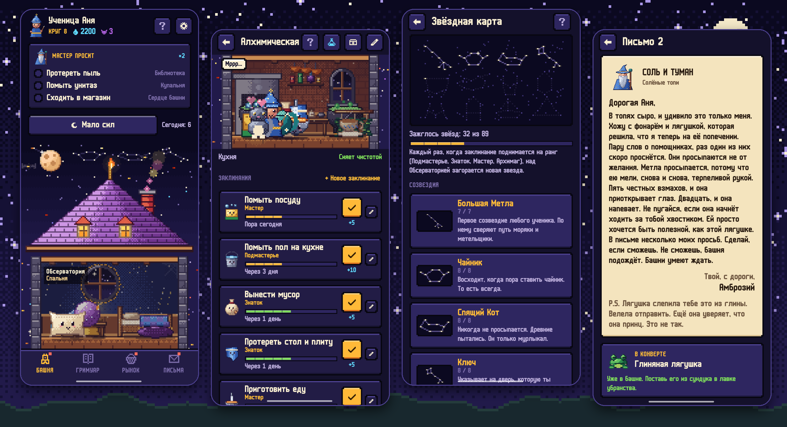

</div>

---

## Идея

Большинство домашних дел не ежедневные. Цветы поливают раз в четыре дня, бельё меняют раз в две недели, духовку моют раз в луну. Список, который каждое утро обнуляется, для этого не подходит, а сгоревшая серия — не то чувство, с которым хочется убираться.

В Hearthspell у каждого дела свой ритм. Его **свежесть** медленно гаснет от сияния до пыли, и вместе с ней тускнеет комната в башне: немного пыли, потом паутинка, а когда срок вышел — пакостник, который жуёт носки и хихикает. Сделал дело, нажал на заклинание, и пакостника выметает. Ничего не сгорает, никто не ругает, а пыльный этаж просто ждёт тебя.

## Башня

| | Что | Как устроено |
|---|---|---|
| 🏰 | **Этажи — комнаты** | 11 видов комнат, у каждой своя пиксельная сцена: кухня — Алхимическая, спальня — Обсерватория под круглым окном, ванная — Купальня, прихожая — Врата, балкон — Оранжерея. А ещё Библиотека, Мастерская игрушек, Скрипторий, Ткацкая, Зверинец и Сердце башни для дел на весь дом. Этажи можно переименовать, переставить и добавить. |
| ✨ | **Заклинания — дела** | 45 готовых заклинаний с разумными сроками, от «помыть посуду» до «помыть духовку», у каждого своё маленькое заклятье. Или своё: любое название, любой срок, три уровня сложности. Заклинание можно поставить на паузу на время отпуска. |
| 😈 | **Пакостники вместо наказаний** | Просроченное заклинание приводит на этаж пакостника. Они безобидные и немного нахальные. Одно заклинание выгоняет одного. |
| 🧹 | **Помощники просыпаются** | 17 помощников (Метла, Губка, Ведро, Чайник, Лейка, Свеча, Ключ, Котомка…), каждый связан со своими заклинаниями. Произнеси заклинание пять раз, и его помощник проснётся и начнёт гулять по этажу; дальше он растёт через четыре уровня. |
| 💧 | **Мана и убранство** | Каждое заклинание приносит ману: 5 за заговор, 10 за заклинание, 20 за великое. Её можно потратить на 21 предмет убранства и сезонные (кот, котёл, телескоп, светящиеся грибы, камин…) и поставить до четырёх на каждый этаж. |
| 📜 | **Просьбы мастера** | Каждую неделю мастер просит о трёх заклинаниях, которые ждут дольше всех. До воскресенья они стоят двойную ману. |
| 🌙 | **Мало сил** | Одна кнопка показывает только маленькие заклинания, самые срочные сверху. Даже маленькое заклинание выгоняет пакостников. |
| 🕯️ | **Живая башня** | Ночью чистый этаж светится тёплым, пыльный тонет в темноте, а этаж с пакостниками мерцает фиолетовым. Поздно ночью помощники дремлют. Когда чисто везде, по небу пролетает комета (днём — радуга). |
| 🐾 | **Всех можно погладить** | Нажми на помощника: он подпрыгнет, что-нибудь скажет, и вверх поплывут сердечки. После первых заклинаний в башню приходит кот, получает имя и спит там, где только что прибрано. Погладишь — замурлычет. |
| 🎃 | **Времена года** | Осенние листья, тыквы и летучие мыши на Хэллоуин, снег на крыше зимой, гирлянды и фейерверки на Новый год, лепестки весной, бабочки летом. Сезонное убранство возвращается каждый год. |

## Остальной дом

- **Гримуар.** Твой круг ученичества, все помощники с уровнями и страница каждого заклинания: заклятье, ранг от Новичка до Архимага и календарь произнесений за двенадцать недель.
- **Рынок.** Список покупок как реагенты для башни, разложенные по отделам с башенными названиями (Дары полей, Молочные реки, Эликсиры чистоты…). Отдел угадывается по названию на русском и английском. Приложение запоминает, как часто ты что покупаешь, и подсказывает, что заканчивается. Режим похода — большой список для одной руки; когда покупки сделаны, произносится твоё заклинание «Сходить в магазин».
- **Письма мастера.** Двенадцать писем, по одному в неделю, от мастера Амброзия из странствий: солёные топи, монастырь молчаливых мётел, старая подруга-дракониха, настоящая причина, почему он уехал, и дорога домой.
- **Одно тихое напоминание в день** голосом помощника, и только если завелись пакостники или пришло письмо.
- **Бестиарий.** Восемнадцать пакостников с именами (Пип Носкожуй, Крошкосвист с кухни, Храпунчик из-под кровати, Тыквенник в простыне…), у каждого свои повадки и прощальная фраза. Кто заведётся, зависит от комнаты и времени года, а не от того, как долго ждало дело.
- **Подарки помощников.** После тихой ночи на чистом этаже помощники могут оставить на подоконнике безделушку: пуговицу, пёрышко, жёлудь, а изредка и осколок звезды. Подарки ждут три дня. На полке семнадцать мест.
- **Звёздная карта.** Каждый ранг заклинания зажигает звезду над Обсерваторией; звёзды складываются в двенадцать созвездий (Большая Метла, Чайник, Дракониха Пудинг…), и зажжённые светятся ночью над крышей.
- **Котёл.** Каждый реагент с рынка оставляет на алхимической полке эссенцию. Из них варятся зелья, от которых никакой пользы, зато башня неделю краше: розовый дым из трубы, радужные светлячки, мыльные пузыри, цветы на стенах.
- **Гардероб.** Мантии и шляпы за ману: венок, лягушачья шапка, ушки, маленькая корона. В них ученик ходит по всем этажам.
- **Сувениры.** В каждом письме мастера что-то лежит: глиняная лягушка, чешуйка дракона, корабль в бутылке, банка северного сияния.
- **Воскресное чаепитие.** В воскресенье помощники собираются за столом и в нескольких тёплых строчках рассказывают о неделе. Без графиков.
- **Возвращение.** Если тебя не было пять дней и больше, мастер встретит тебя, а первое заклинание станет Великой весенней уборкой с конфетти и двойной маной. За отсутствие ничего не отнимается.
- **Звук и вибрация.** Маленькие 8-битные звуки, синтезированные прямо на телефоне; заклинания подряд поднимаются по гамме, и вибрация чуть растёт.
- **Виджет на рабочий стол**: башня снаружи, окна тёплые там, где чисто, и фиолетовые (с парой жёлтых глаз) там, где завелись пакостники.

<table>
  <tr>
    <td>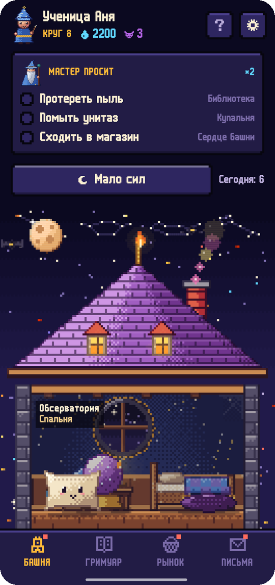</td>
    <td>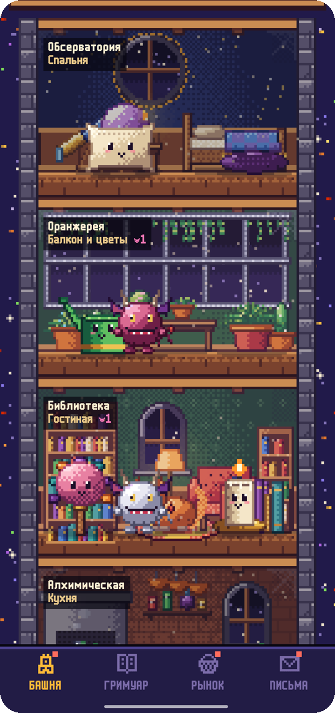</td>
    <td>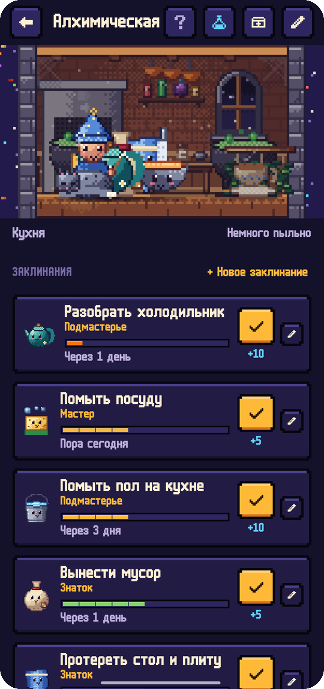</td>
    <td>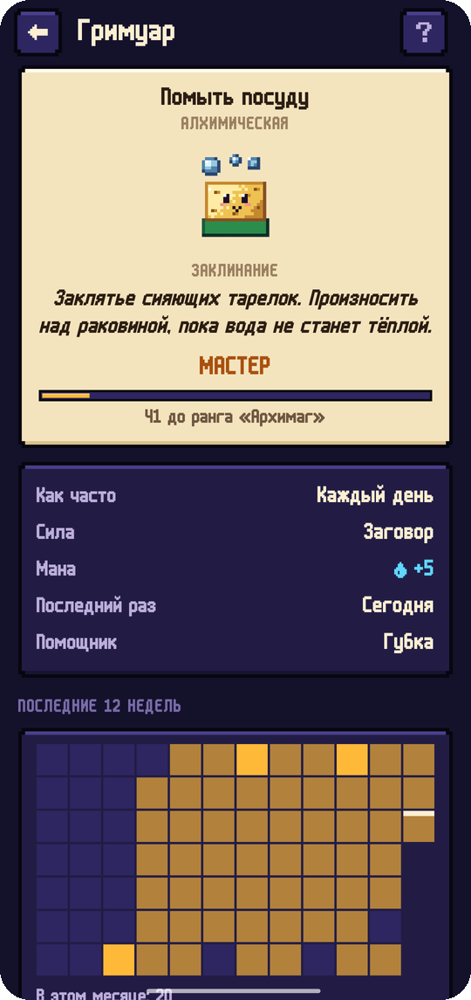</td>
  </tr>
  <tr>
    <td>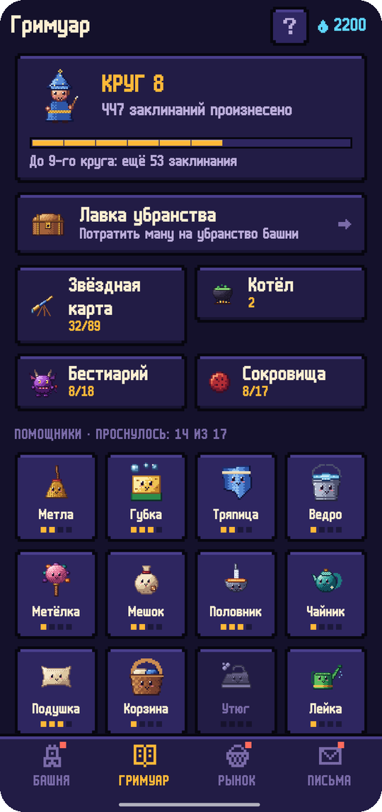</td>
    <td>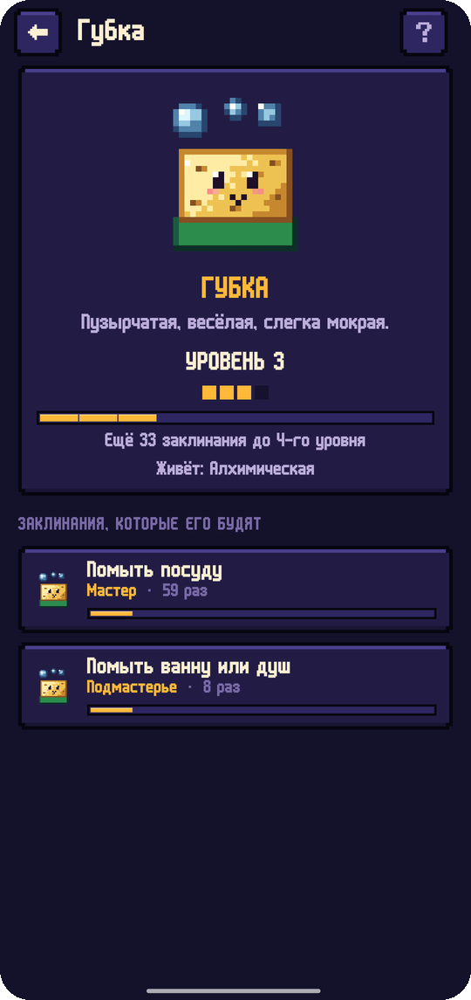</td>
    <td>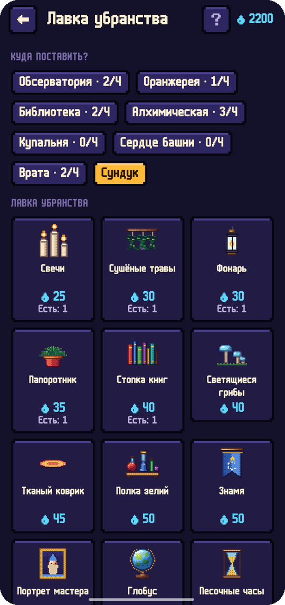</td>
    <td>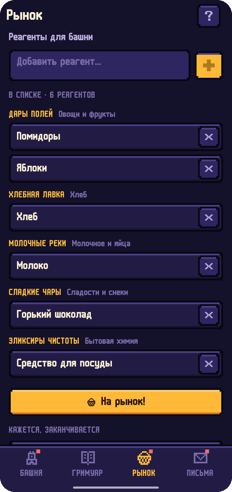</td>
  </tr>
  <tr>
    <td>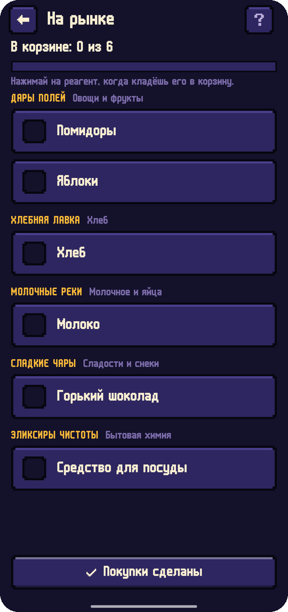</td>
    <td>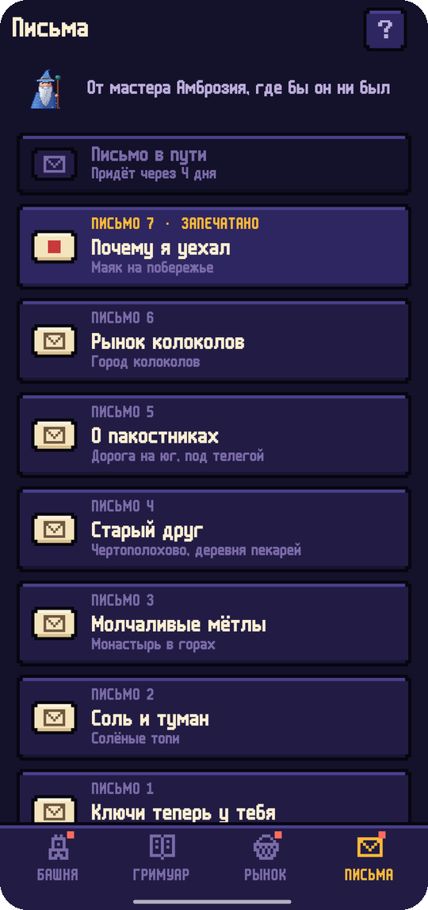</td>
    <td>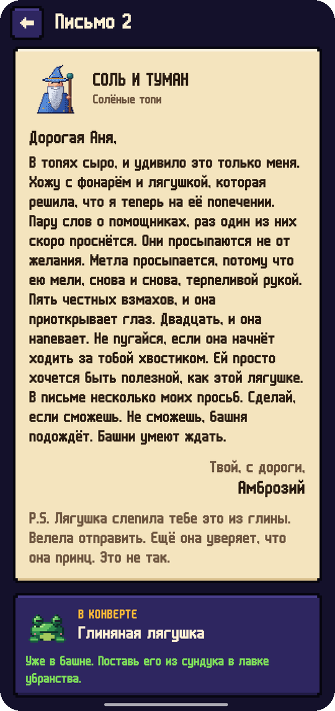</td>
    <td>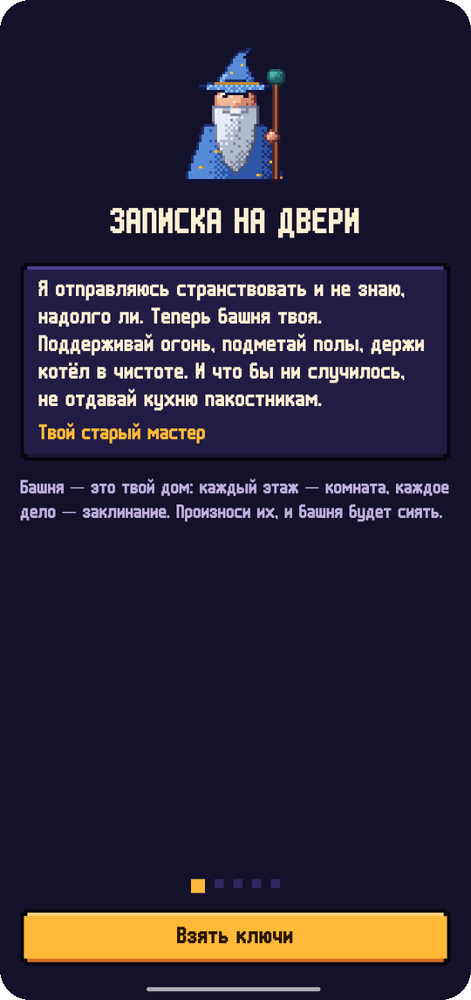</td>
  </tr>
  <tr>
    <td>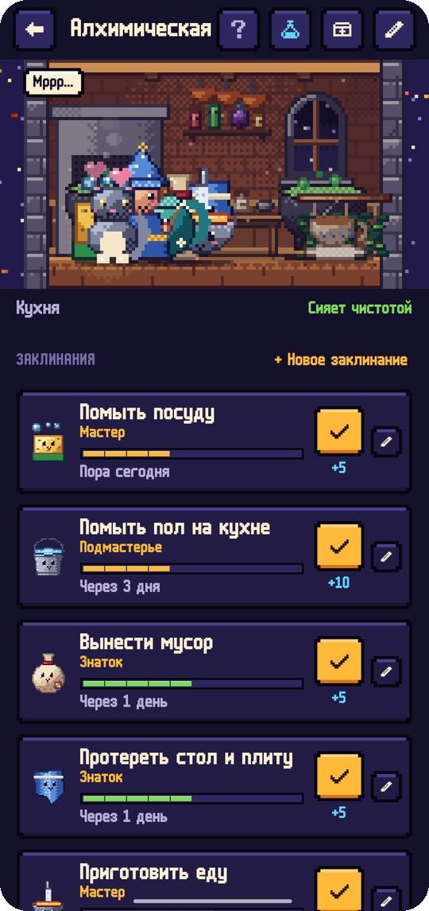</td>
    <td>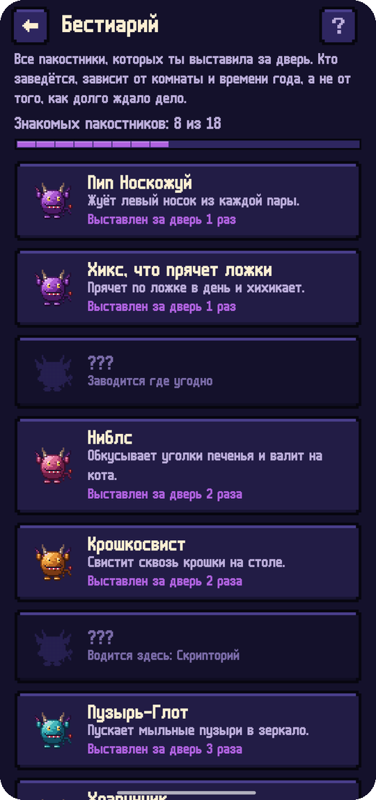</td>
    <td>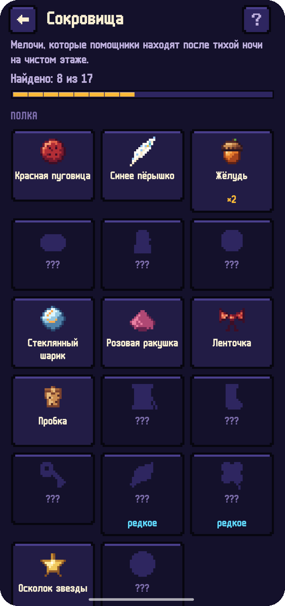</td>
    <td>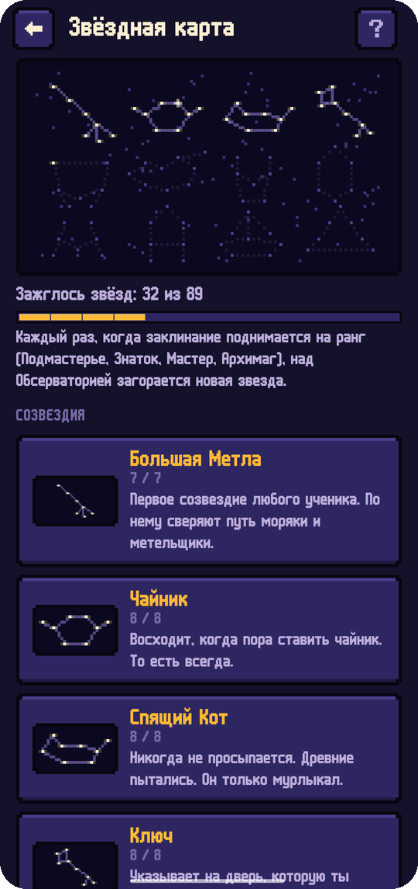</td>
  </tr>
  <tr>
    <td>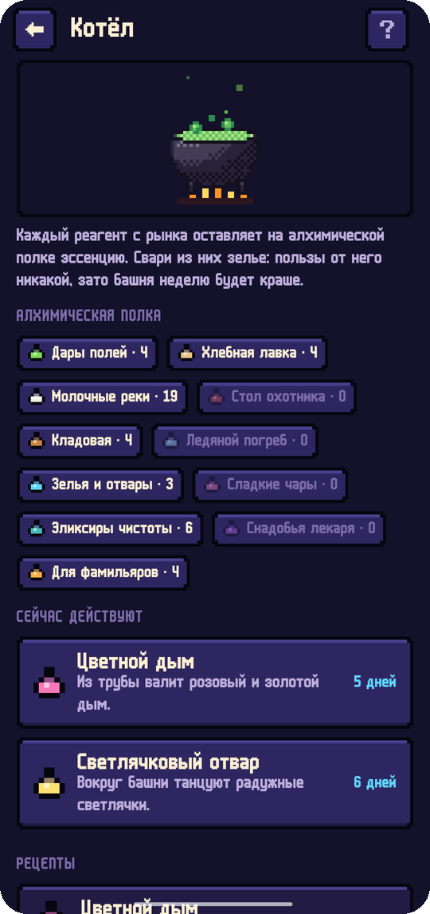</td>
    <td>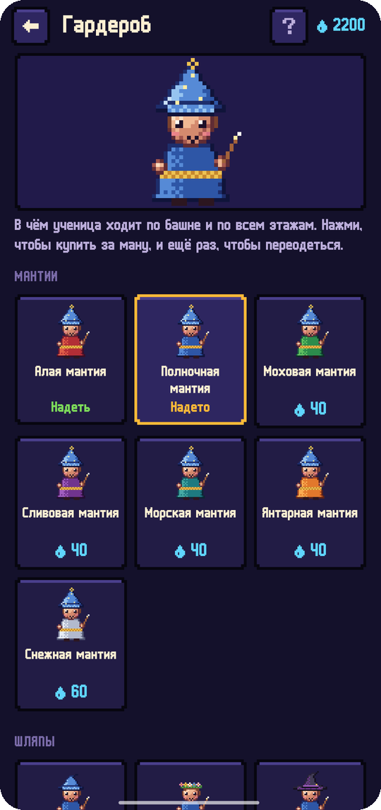</td>
    <td>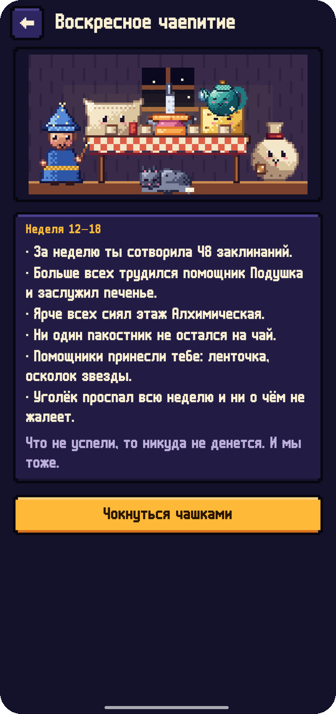</td>
    <td></td>
  </tr>
</table>

## Русский и English

Все экраны, заклинания, заклятья и письма написаны на обоих языках вручную, а не машинным переводом. По-русски приложение спрашивает, ученик ты или ученица, и мастер пишет тебе соответственно. Язык меняется в **Настройки → Язык**; на Android 13+ приложение есть и в системных настройках языка для приложений.

## Скачать

APK лежит в **[Releases](https://github.com/bigdevwhale/hearthspell/releases/latest)**, а отладочный APK прикреплён к каждому [запуску CI](https://github.com/bigdevwhale/hearthspell/actions/workflows/android.yml). Нужен Android 8.0 (API 26) или новее.

> [!TIP]
> На Xiaomi (MIUI / HyperOS), Huawei и некоторых других телефонах разреши **Автозапуск** и сними ограничения батареи, чтобы ежедневное напоминание приходило вовремя.

## Приватность

У Hearthspell нет аккаунтов, серверов, аналитики, рекламы и разрешения на интернет. Башня, заклинания, история и список покупок хранятся на телефоне. **Настройки → Резервная копия** выгружает всё в один JSON-файл, который остаётся у тебя.

## Как устроено

- **Kotlin + Jetpack Compose** со своим пиксельным интерфейсом: панели со ступенчатыми углами, кнопки, которые проседают при нажатии, сегментные полосы, пиксельный шрифт m6x11 Дэниела Линссена с кириллицей от Natto Games. Ночная тема и тема «пергамент».
- **Пиксель-арт рисует код.** В `tools/art/` лежат Python-скрипты (Pillow), которые рисуют всех помощников, пакостников, убранство, сцены этажей и иконку: цветовые рампы со сдвигом оттенка, затенение по нормалям, упорядоченный дизеринг, выборочные контуры и ступенчатое свечение. `export.py` записывает спрайты в `ui/art/Art.kt`, а сцены в `res/drawable-nodpi`. В приложении спрайты рисуются из кэшированных картинок без сглаживания и остаются чёткими при любом масштабе.
- **Room** хранит этажи, заклинания, произнесения, реагенты и убранство; **DataStore** — настройки.
- `domain/World` держит правила: свежесть и пакостники, ранги, уровни помощников, мана, просьбы мастера, письма и то, что заканчивается. Это обычный Kotlin, покрытый юнит-тестами.

```
app/src/main/java/app/hearthspell/
├── content/     этажи, заклинания, помощники, убранство, отделы, письма, угадывание отдела (EN + RU)
├── data/        база Room, настройки, JSON-бэкап, демо-данные
├── domain/      свежесть, ранги, помощники, мана, просьбы, родовые формы
├── notify/      ежедневное напоминание
└── ui/          башня, гримуар, рынок, письма, убранство, онбординг, настройки, пиксель-арт
tools/art/       генератор пиксель-арта
```

Сборка: `./gradlew assembleDebug`. `./gradlew installDebug -Pdemo` ставит `app.hearthspell.demo` с обжитой башней и двумя месяцами истории — с неё сняты эти скриншоты.

## Лицензия

[MIT](LICENSE). Часть [Stillcraft](https://bigdevwhale.github.io/stillcraft/) — маленьких инструментов для спокойной головы.
